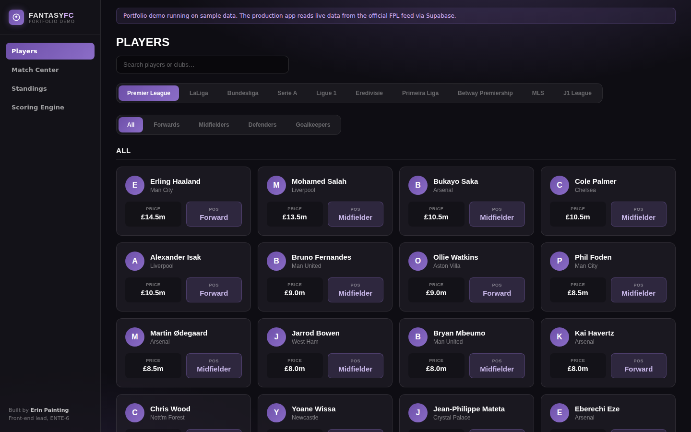
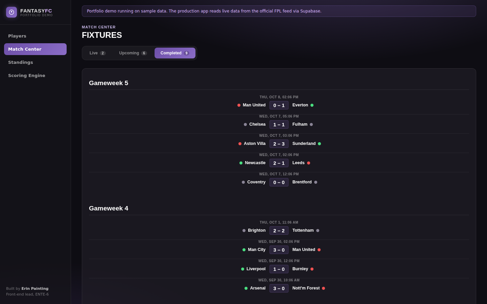
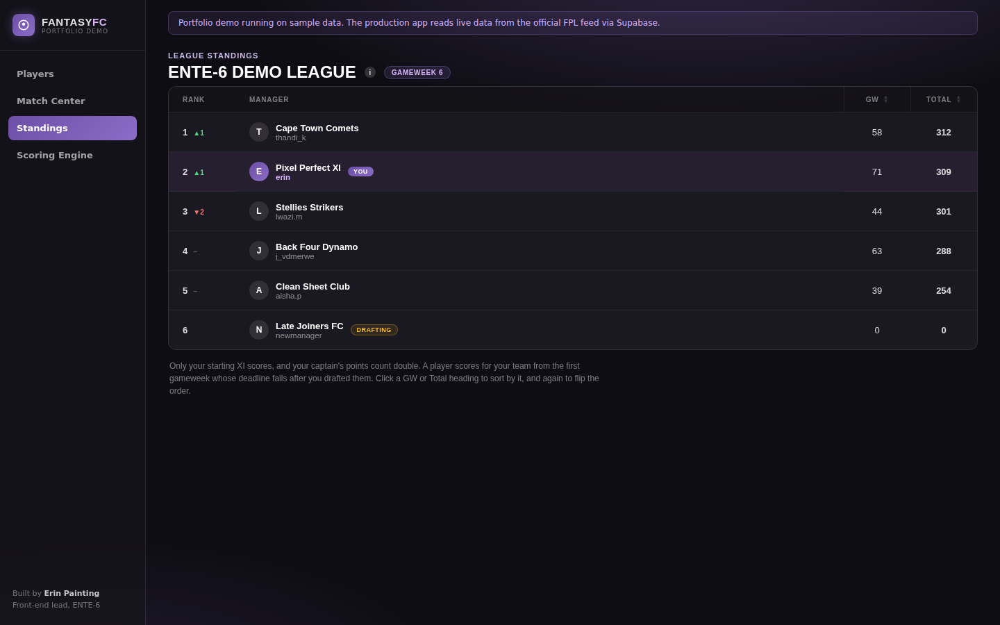
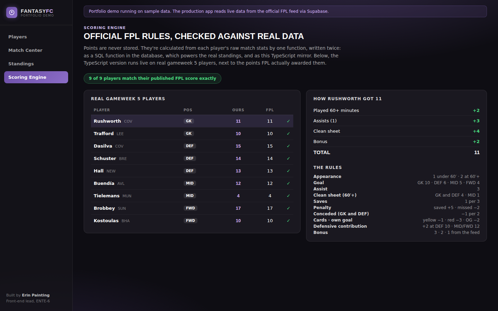
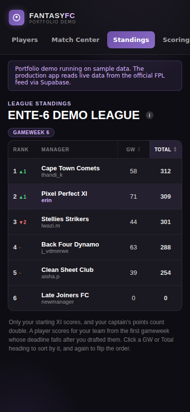

# FantasyFC: fantasy football for Entelect

A fantasy football web app built by a team of five for **Entelect**, a South African software consultancy, as our third-year software engineering project at Stellenbosch University (RW344, 2026).

I was the **front-end and UI/UX lead**. I designed the interface, built the Players, Match Center and Standings pages, and wrote the TypeScript version of the scoring engine and its tests.

**Live demo:** _add your Vercel link here after deploying (see [Deploy](#deploy))_

[](https://vercel.com/new/clone?repository-url=https://github.com/paintingerin1-rgb/Erin_Painting_portfolio&root-directory=fantasyfc)



| Match Center | Standings |
| --- | --- |
|  |  |

| Scoring engine, checked against real FPL data | Mobile |
| --- | --- |
|  |  |

---

## About this folder

The full project lives in the university's private GitLab and was built for a client, so I can't publish the whole codebase. This folder is a runnable showcase of **the parts I built**, using my component code from the final release.

The one thing I changed is the data layer. In production, every page reads from Supabase (Postgres) through a small API file. Here those API files return sample data behind the **same function signatures**, so the pages themselves are unchanged, and the demo runs anywhere with no backend, keys or setup.

---

## The project in brief

**The brief:** a fantasy football manager that's simpler than the official Fantasy Premier League app, with official FPL scoring identical in every league and Google sign-in only. Our guiding line was *fewer screens, less clutter, and nothing on the interface that needs explaining.*

**What a manager can do in the final product:** discover and join leagues from a 3D globe across **10 competitions** (including South Africa's PSL, the MLS and Japan's J1 League), draft a 15-player squad within a £100m budget, set a starting eleven that locks at the gameweek deadline, follow real fixtures and results, track a live league table, and chat with their league.

**Stack:** React 19, TypeScript, Vite, React Router, and Supabase (Postgres, Google OAuth and row-level security), deployed on Vercel. Data comes from football-data.org, the ESPN API and the official FPL feed.

**Team:** five developers over three sprints. Each sprint ended in a review and a live demo for Entelect.

---

## My role

### UI/UX design (mine end to end)

- Before any code, I drew up questions for the client, wireframed **13 screens**, and wrote the **style guide**: the colour system, the typography (Oswald for headings and numbers, Inter for body text) and the component patterns the whole team built on.
- I iterated on the design through Q&A sessions with the client and their visual feedback each sprint.
- The visual direction is *matchday at night*: a dark stadium feel, one violet accent so it's always clear what's clickable, and a scoreboard-style font for the numbers that matter.
- For anything with more than one reasonable design, I built clickable HTML previews of the options before writing component code. For example, I mocked three versions of the Standings sort control in the app's real colours, and we picked the clearest one.

### Pages and components I built

| What | Highlights |
| --- | --- |
| **Players** | Search by player or club, position and league filters, server-side pagination with a stable sort, equal-size cards |
| **Match Center** | Live / upcoming / completed tabs, fixtures grouped by gameweek, real results from the FPL feed |
| **Standings** | League table with rank movement, sortable by gameweek or total points, a scoring tooltip for new players, "you" highlighting |
| **FixtureRow** (with Dannike) | One shared fixture component for the Dashboard and Match Center: teams centred on a "vs" or the score, plus a won/drew/lost dot for each side |
| **Dashboard polish** | Live gameweek countdown, centred fixtures |
| **Date formatting** | One shared formatter for every kickoff and deadline, so pages can't drift apart |
| **Scoring engine (TypeScript)** | Official FPL rules as a pure function, tested rule by rule and against real players' published scores |

---

## Sprint by sprint

### Sprint 1: Foundations

**What I did:** the client questions, the 13 wireframes and the style guide. I scaffolded the React + TypeScript + Vite app with routing and Google sign-in, and built the first versions of the main pages.

**What worked:** designing before coding. We agreed scope with the client early, and the app looked like one product even with five people building it.

**What didn't:**
- At the review, Entelect told us it was hard to see who built what, our agile process wasn't visible, we had no tests, and the demo ran over time.
- Two of us built the same component in parallel without knowing it. Git flagged it as an add/add conflict, because our branches had lived too long without touching the main branch.
- The production site ran a version behind at the demo, because deploys were manual.

**What we changed:**
- We protected the main branch: every change goes through a merge request, branches live at most three days, and you post what you're picking up before starting.
- Every merge request needs one approval from someone else, never yourself.
- We added a CI pipeline (lint, tests and build) that blocks a merge if anything fails, and automated deployment.
- We built a who-did-what table from our commit history, and planned the next demo to the minute.

### Sprint 2: The engine

**What I did:**
- Connected the Players page to real data (548 Premier League players) with server-side search, filtering and pagination.
- Built Match Center on real fixtures from the official FPL feed, and the first live Standings.
- Wrote the TypeScript scoring engine with **43 rule-by-rule tests**.

**What worked:**
- The scoring rules exist twice on purpose: as a SQL function in the database, which powers the real standings, and as my TypeScript version. Checking both against the same rules caught a real bug: a substitute who played ten minutes was getting clean-sheet points, when the rule needs sixty. My tests check exactly that boundary, 59 minutes against 60.
- The CI gate and required reviews meant nothing broken reached the main branch.

**What didn't:**
- Player prices came out in flat tiers (only 8 different prices across 548 players), and the client flagged it.
- The draft made it hard to see who you'd already picked.
- We didn't run a retrospective that sprint.
- I also hit a class of bug I hadn't expected: all the CSS ends up in one bundle, so two pages using the same class name quietly overwrite each other.

**What we changed:** Entelect gave us six points of feedback, and each one became an item in the Sprint 3 backlog with a visible answer. Pricing was reworked so it depends on a player's status, not just their club. I started giving every page's CSS its own prefix.

### Sprint 3: Scale and polish

**What I did** (from a shared pool of small, specific tickets):
- **Standings:** sortable gameweek and total columns, plus an "i" tooltip that explains scoring in place.
- **Dashboard:** a live "Gameweek begins in" countdown, and one shared date formatter.
- **FixtureRow:** a shared component, so a fixture looks identical everywhere, with result dots.
- **Players:** all cards the same size, and search moved below the header.
- **CSS collisions:** I tracked two down. The Draft page's 280px-tall card class was leaking onto the Players page, and the Dashboard and Match Center fixture styles were overwriting each other. Fixed by giving each page its own class names.

**The rest of the team** delivered the 3D globe, the expansion from one league to ten, the gameweek lineup lock, starting-eleven scoring, and chat moderation.

**What worked:**
- Small tickets with clear acceptance criteria kept merge requests easy to review.
- Agreeing a design before building it (through the HTML previews) cut down on rework.

**What didn't:**
- Some polish tickets depended on a shared component that didn't exist yet, so we had to sequence the work carefully.
- Our tests are strongest on scoring and data matching, and thinner on the interface.

**The retrospective:** instead of a separate end-of-sprint retro, we held an in-depth retrospective on the whole project when we visited Entelect's Cape Town office.

---

## Working with Entelect

- We were in regular contact with Entelect throughout: briefs at the start of each sprint, a review and live demo at the end, and their feedback shaped the next sprint's backlog.
- We visited **Entelect's office in Cape Town** to demo the product live.
- **Entelect were very happy with the final product.**

## How we worked

- **Sprints:** each was planned from the client's brief into a prioritised backlog (P0/P1). Issues sat in an open pool, and you claimed one rather than being assigned it.
- **Trunk-based development:** a protected main branch, short branches of at most three days, and a merge request with one approval from someone else for every change.
- **CI/CD:** lint, tests and a full TypeScript build on every merge request. A failure blocks the merge, and a merge to main deploys automatically.
- **Coordination:** a one-line message in our dev channel before starting a task, so nobody duplicated work.
- **Reviews and retrospectives** with the client at the end of each sprint.

By the final release, the project had around **280 automated tests**.

---

## Technical highlights

If you're an engineer reviewing this, these are the parts worth reading:

1. **A scoring engine verified against reality.** [`src/features/scoring/fplPoints.ts`](src/features/scoring/fplPoints.ts) is a pure function: stats and position in, points out. Its tests feed in nine real players' gameweek-5 stat lines and check the output matches the points FPL actually published, covering every position and every threshold rule. The demo's *Scoring Engine* page runs it live in the browser and shows the breakdown rule by rule.
2. **Points are derived, never stored.** Only raw match stats are saved. If a rule changes, every score recalculates with no data migration.
3. **Stable pagination.** [`playersApi.ts`](src/features/players/playersApi.ts) sorts by price and then by ID. Many players share a price, and without a unique tie-breaker, page 2 could repeat or skip a player from page 1.
4. **Logic kept testable.** [`formatCountdown`](src/lib/dateFormat.ts) takes the current time as a parameter, so it can be tested without fake timers. [`fixtureResult.ts`](src/components/FixtureRow/fixtureResult.ts) keeps the won/drew/lost logic out of the component.
5. **Accessibility.** The sort headers are real buttons with `aria-sort`, the tooltip opens on keyboard focus, and the result dots have text labels for screen readers.

---

## What's in this folder

```
src/
  components/
    FixtureRow/          shared fixture row + result logic (+ tests)
    Layout/              sidebar shell for the demo
  features/
    players/             Players page (+ test)
    matchCenter/         Match Center page
    standings/           Standings page (+ tests: sorting, empty and error states)
    scoring/             FPL scoring engine (+ 53 tests) and the Scoring Engine page (+ 2)
    */…Api.ts            data layer: sample data here, Supabase in production
  lib/dateFormat.ts      shared kickoff / countdown formatting (+ tests)
  data/                  sample data and real gameweek-5 stat lines
```

**84 tests**, run with Vitest and React Testing Library.

## Run it locally

You'll need Node 20.19 or newer.

```bash
cd fantasyfc
npm install
npm run dev      # http://localhost:5173
npm test         # 84 tests
npm run build
```

## Deploy

Click the **Deploy with Vercel** button at the top, or deploy by hand:

1. Import this repository into Vercel.
2. Set the **Root Directory** to `fantasyfc`.
3. Click Deploy. Vercel detects Vite automatically, and `vercel.json` handles page routing.

No environment variables are needed.

A GitHub Actions workflow (`.github/workflows/fantasyfc-ci.yml`) runs lint, tests and a build on every push that touches this folder.

## What I'd do next

- Widen the UI test coverage to match the logic tests.
- Move to scoped styles (CSS Modules), which makes the class-collision bugs impossible.
- Code-split the pages and compress the large images to cut the first load in production.
- Merge the two TypeScript scoring files into one.

## Team

FantasyFC was built by **Danny** (backend lead: data pipelines, the globe, CI), **Gajen** (draft, pricing, test infrastructure), **Ben** (globe integration, chat), **Dannike** (client spokesperson, squad layout) and me, **Erin** (front-end and UI/UX lead).
