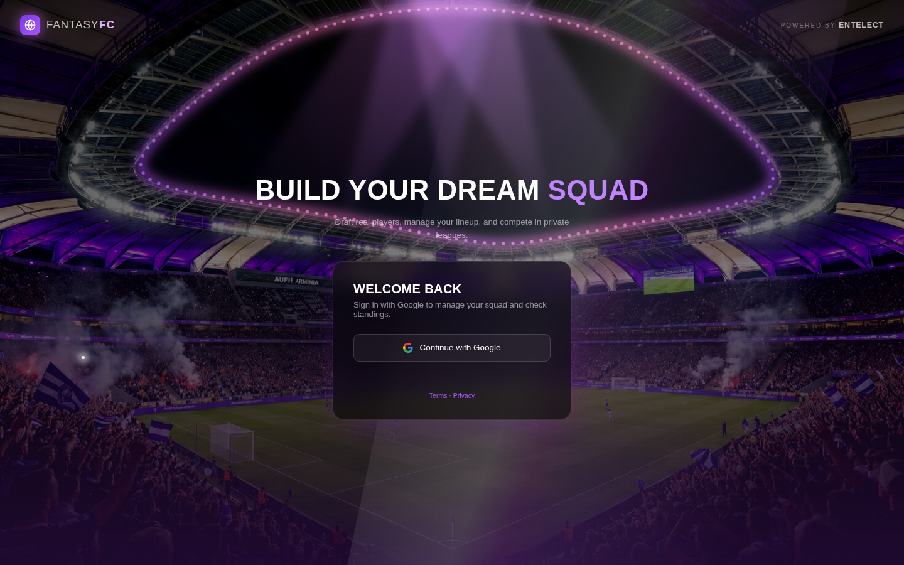
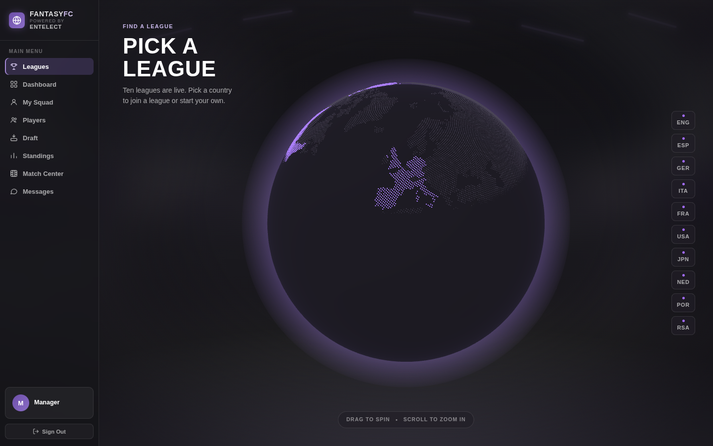

# FantasyFC: fantasy football for Entelect

A full-stack fantasy football web app built by a team of five for **Entelect**, a South African software consultancy, as our third-year software engineering project at Stellenbosch University (RW344, 2026).

I was the **front-end and UI/UX lead**. I designed the interface, built the Players, Match Center and Standings pages, and wrote the TypeScript version of the scoring engine and its tests.

**Live app:** [cuneiform-project.vercel.app](https://cuneiform-project.vercel.app) (the team's deployment; sign in with any Google account)





---

## What it does

A manager signs in with Google, then:

- **Discovers leagues on a 3D globe** across 10 competitions: the Premier League, LaLiga, Bundesliga, Serie A, Ligue 1, Eredivisie, Primeira Liga, South Africa's PSL, the MLS and Japan's J1 League.
- **Creates or joins a league**, public or private with a join code.
- **Drafts a 15-player squad** within a £100m budget. Position limits and budget checks run on the server, so they can't be bypassed from the browser.
- **Sets a starting eleven** on a single-screen pitch view. Lineups lock at the gameweek deadline, and only starters score.
- **Follows real fixtures and results**, grouped by gameweek, in the Match Center.
- **Tracks a live league table** with rank movement, sortable by gameweek or total points.
- **Chats with their league** in real time, with commissioner moderation.

Scoring follows the official Fantasy Premier League rules, identical in every league, and is calculated from real match statistics.

## Tech stack

| Layer | Choice |
| --- | --- |
| Frontend | React 19, TypeScript, Vite, React Router |
| 3D globe | Three.js via React Three Fiber, d3-geo, world-atlas |
| Backend | Supabase: Postgres, Google OAuth, row-level security, realtime |
| Data | football-data.org, the official FPL API, the ESPN API |
| Testing | Vitest and React Testing Library: **281 tests across 27 files** |
| CI/CD | Lint, test and build on every merge request, with automatic deploys to Vercel |

There's no separate API server. The browser talks to Postgres through Supabase, every table is protected by row-level security policies, and sensitive actions like drafting a player or joining a league run as database functions.

---

## My role

### UI/UX design (mine end to end)

- Before any code, I drew up questions for the client, wireframed **13 screens**, and wrote the **style guide**: the colour system, the typography (Oswald for headings and numbers, Inter for body text) and the component patterns the whole team built on.
- I iterated on the design through Q&A sessions with the client and their visual feedback each sprint.
- The visual direction is *matchday at night*: a dark, floodlit-stadium feel, one violet accent so it's always clear what's clickable, and a scoreboard-style font for the numbers that matter.
- For anything with more than one reasonable design, I built clickable HTML previews of the options before writing component code. For example, I mocked three versions of the Standings sort control in the app's real colours, and we picked the clearest one.

### Code I wrote

| Area | Where | Highlights |
| --- | --- | --- |
| **Players page** | [`src/features/players`](src/features/players) | Search by player or club, position and league filters, server-side pagination with a stable sort, equal-size cards |
| **Match Center** | [`src/features/matchCenter`](src/features/matchCenter) | Live / upcoming / completed tabs, fixtures grouped by gameweek |
| **Standings** | [`src/features/standings`](src/features/standings) | Rank movement, sortable gameweek and total columns, a scoring tooltip for new players, "you" highlighting |
| **FixtureRow** (with Dannike) | [`src/components/FixtureRow`](src/components/FixtureRow) | One shared fixture component for the Dashboard and Match Center: teams centred on "vs" or the score, plus won/drew/lost dots |
| **Dashboard polish** | [`src/features/dashboard`](src/features/dashboard) | Live "Gameweek begins in" countdown, centred fixtures |
| **Date formatting** | [`src/lib/dateFormat.ts`](src/lib/dateFormat.ts) | One shared formatter for every kickoff and deadline |
| **Scoring engine (TypeScript)** | [`src/features/scoring`](src/features/scoring) | Official FPL rules as a pure function, with 43 rule-by-rule tests plus tests against real players' published scores |

---

## Sprint by sprint

### Sprint 1: Foundations

**What I did:** the client questions, the 13 wireframes and the style guide. I scaffolded the React + TypeScript + Vite app with routing and Google sign-in, and built the first versions of the main pages.

**What worked:** designing before coding. We agreed scope with the client early, and the app looked like one product even with five people building it.

**What didn't:**
- At the review, Entelect told us it was hard to see who built what, our agile process wasn't visible, we had no tests, and the demo ran over time.
- Two of us built the same component in parallel without knowing it. Git flagged it as an add/add conflict, because our branches had lived too long without touching the main branch.
- The production site ran a version behind at the demo, because deploys were manual.

**What we changed:**
- We protected the main branch: every change goes through a merge request, branches live at most three days, and you post what you're picking up before starting. This is all written up in [`CONTRIBUTING.md`](CONTRIBUTING.md).
- Every merge request needs one approval from someone else, never yourself.
- We added a CI pipeline (lint, tests and build) that blocks a merge if anything fails, and automated deployment.
- We built a who-did-what table from our commit history, and planned the next demo to the minute.

### Sprint 2: The engine

**What I did:**
- Connected the Players page to real data (548 Premier League players) with server-side search, filtering and pagination.
- Built Match Center on real fixtures from the official FPL feed, and the first live Standings.
- Wrote the TypeScript scoring engine with **43 rule-by-rule tests**.

**What worked:**
- The scoring rules exist twice on purpose: as a SQL function in the database, which powers the real standings, and as my TypeScript version. Checking both against the same rules caught a real bug: a substitute who played ten minutes was getting clean-sheet points, when the rule needs sixty. My tests check exactly that boundary, 59 minutes against 60.
- The CI gate and required reviews meant nothing broken reached the main branch.

**What didn't:**
- Player prices came out in flat tiers (only 8 different prices across 548 players), and the client flagged it.
- The draft made it hard to see who you'd already picked.
- We didn't run a retrospective that sprint.
- I also hit a class of bug I hadn't expected: all the CSS ends up in one bundle, so two pages using the same class name quietly overwrite each other.

**What we changed:** Entelect gave us six points of feedback, and each one became an item in the Sprint 3 backlog with a visible answer. Pricing was reworked: Premier League players now use FPL's own prices, and every other league is ranked by a status score. I started giving every page's CSS its own prefix.

### Sprint 3: Scale and polish

**What I did** (from a shared pool of small, specific tickets):
- **Standings:** sortable gameweek and total columns, plus an "i" tooltip that explains scoring in place.
- **Dashboard:** a live "Gameweek begins in" countdown, and one shared date formatter.
- **FixtureRow:** a shared component, so a fixture looks identical everywhere, with result dots.
- **Players:** all cards the same size, and search moved below the header.
- **CSS collisions:** I tracked two down. The Draft page's 280px-tall card class was leaking onto the Players page, and the Dashboard and Match Center fixture styles were overwriting each other. Fixed by giving each page its own class names.

**The rest of the team** delivered the 3D globe, the expansion from one league to ten, the gameweek lineup lock, starting-eleven scoring, and chat moderation.

**What worked:**
- Small tickets with clear acceptance criteria kept merge requests easy to review.
- Agreeing a design before building it (through the HTML previews) cut down on rework.

**What didn't:**
- Some polish tickets depended on a shared component that didn't exist yet, so we had to sequence the work carefully.
- Our tests are strongest on scoring and data matching, and thinner on the interface.

**The retrospective:** instead of a separate end-of-sprint retro, we held an in-depth retrospective on the whole project when we visited Entelect's Cape Town office.

---

## Working with Entelect

- We were in regular contact with Entelect throughout: briefs at the start of each sprint, a review and live demo at the end, and their feedback shaped the next sprint's backlog.
- We visited **Entelect's office in Cape Town** to demo the product live.
- **Entelect were very happy with the final product.**

## How we worked

- **Sprints:** each was planned from the client's brief into a prioritised backlog (P0/P1). Issues sat in an open pool, and you claimed one rather than being assigned it.
- **Trunk-based development:** a protected main branch, short branches of at most three days, and a merge request with one approval from someone else for every change.
- **CI/CD:** lint, tests and a full TypeScript build on every merge request. A failure blocks the merge, and a merge to main deploys automatically.
- **Coordination:** a one-line message in our dev channel before starting a task, so nobody duplicated work.
- **Reviews and retrospectives** with the client at the end of each sprint.

The full team workflow is in [`CONTRIBUTING.md`](CONTRIBUTING.md).

---

## Technical highlights

If you're an engineer reviewing this, these are the parts worth reading:

1. **A scoring engine checked against reality.** [`fplPoints.ts`](src/features/scoring/fplPoints.ts) is a pure function: stats and position in, points out. Its tests feed in real players' gameweek-5 stat lines and check the output matches the points FPL actually published. The database has its own SQL version of the same rules, which powers the live standings.
2. **Points are derived, never stored.** Only raw match stats are saved. If a rule changes, every score recalculates with no data migration.
3. **Security in the database, not the browser.** Row-level security on every table, and server-side functions for drafting, budgets and league membership. See [`supabase/migrations`](supabase/migrations).
4. **Stable pagination.** [`playersApi.ts`](src/features/players/playersApi.ts) sorts by price and then by ID. Many players share a price, and without a unique tie-breaker, page 2 could repeat or skip a player from page 1.
5. **Logic kept testable.** [`formatCountdown`](src/lib/dateFormat.ts) takes the current time as a parameter, so it can be tested without fake timers. [`fixtureResult.ts`](src/components/FixtureRow/fixtureResult.ts) keeps the won/drew/lost logic out of the component.
6. **Reproducible data pipelines.** Ingestion scripts in [`scripts/`](scripts) load squads, fixtures and stats for all 10 leagues, and are safe to re-run.

---

## Project structure

```
src/
  features/        one folder per page: globe, leagues, draft, squad, players,
                   matchCenter, standings, dashboard, messages, scoring, auth
  components/      shared UI: FixtureRow, Sidebar, LeagueSwitcher, PlayerCard, ...
  contexts/        the current league, shared across every page
  lib/             Supabase client, data-access helpers, date formatting
supabase/
  migrations/      database schema, functions and row-level security policies
scripts/           data ingestion and seeding for all 10 leagues (+ tests)
docs/TECHNICAL.md  the team's full developer guide
```

## Running it yourself

The app needs a Supabase project behind it. A free one is enough.

1. **Create a Supabase project**, then apply the schema:
   ```bash
   cd fantasyfc
   npm install
   npx supabase link --project-ref <your-project-ref>
   npx supabase db push
   ```
2. **Enable Google sign-in:** in Supabase, go to Authentication → Providers → Google, and add your site URL under the redirect URLs.
3. **Add your keys:**
   ```bash
   cp .env.example .env.local   # then fill in your project URL and publishable key
   ```
4. **Load football data:** the ingestion scripts need a service-role key and a free football-data.org key in a gitignored `.env.ingest`. The run order is in [`docs/TECHNICAL.md`](docs/TECHNICAL.md#loading-football-data).
5. **Start it:**
   ```bash
   npm run dev      # http://localhost:5173
   npm test         # 281 tests, no database needed
   ```

**Deploying to Vercel:** import the repo, set the **Root Directory** to `fantasyfc`, and add `VITE_SUPABASE_URL` and `VITE_SUPABASE_PUBLISHABLE_KEY` as environment variables. Then add the Vercel URL to your Supabase redirect URLs.

A GitHub Actions workflow (`.github/workflows/fantasyfc-ci.yml`) runs lint, tests and a build on every push that touches this folder.

## What I'd do next

- Widen the UI test coverage to match the logic tests.
- Move to scoped styles (CSS Modules), which makes the class-collision bugs impossible.
- Code-split the pages, especially the globe, and compress the large background images to speed up the first load.
- Merge the two TypeScript scoring files into one.

## Team

FantasyFC was built by **Danny** (backend lead: data pipelines, the globe, CI), **Gajen** (draft, pricing, test infrastructure), **Ben** (globe integration, chat), **Dannike** (client spokesperson, squad layout) and me, **Erin** (front-end and UI/UX lead).
