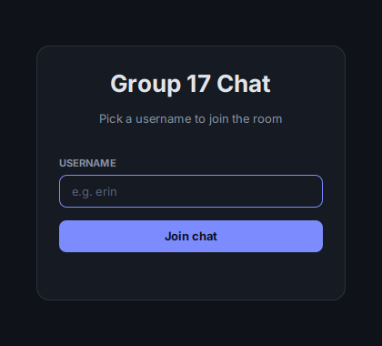
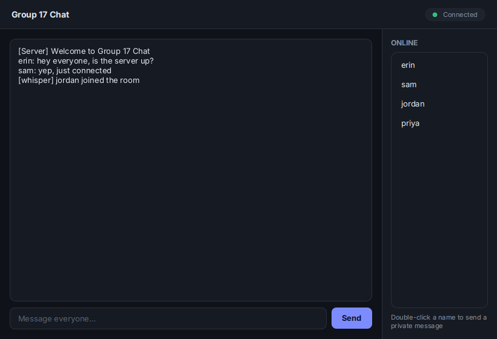

# Group 17 Chat

A multi-user chat app in Java. One server, any number of clients, a JavaFX window on the client side. You can talk to the whole room or open a private chat with one person.

This was the first of four networking projects for CS313 at Stellenbosch (2026). I worked on it with three other people.

<p>
  
  
</p>

## What it does

- Join with a unique username (the server rejects duplicates)
- Global chat that everyone sees
- Private messages: double-click a name in the online list and a whisper window opens
- Live online-users list that updates as people join and leave
- Plain Java sockets, with one thread per client on the server and a shared `Message` object sent over the wire

## My part

I did the UI and the integration work on the client: the login and chat screens, the private chat windows, and wiring them up to the networking code. My files were `ChatApp`, `ChatController`, `ChatUI.fxml`, `client.java` and the shared `Message` class, plus the Makefile and READMEs, and I helped with the experiments. Courtney worked on the client with me, and Ryan and Kayla built the server.

For this portfolio version I also restyled the whole UI. The behaviour is the same as the original submission, it just looks a lot better now.

## What we measured

The brief asked for three experiments. The short version:

- **Message size vs delivery time:** doubling the message length did not double the time. After the first message, delivery stayed around 43 to 53 ms, so connection overhead mattered more than payload size.
- **How many clients can connect:** 18,728 clients, the same in all three trials. The server failed when the OS ran out of sockets.
- **Concurrent messages vs latency:** latency went up as more messages were sent at once (about 1.1 ms for 2 messages, 1.9 ms for 5). The very first message was a consistent outlier, which we put down to test setup.

The full write-up is in the Word document in this repo.

## Run it

You need Java 17+ and JavaFX (`sudo apt install openjfx` on Ubuntu). Then, from the project folder:

```bash
make run-server                      # terminal 1, port 5000
make run-client                      # terminal 2 (run more for more users)
```

To connect to a server on another machine:

```bash
make run-client HOST=<server-ip> PORT=5000
```

If your JavaFX lives somewhere else, add `JAVAFX_PATH=/path/to/javafx-sdk/lib` to any of those commands. `make clean` deletes the compiled output.

We ran the server and clients on different laptops over Tailscale, so use your Tailscale IP if you try it across machines.

## Project structure

```
.
├── Makefile
├── README.md
├── docs/                  screenshots
└── src
    ├── client
    │   ├── ChatApp.java           entry point
    │   ├── LoginController.java
    │   ├── ChatController.java    global chat + whisper windows
    │   ├── client.java            socket connection to the server
    │   ├── login.fxml
    │   ├── ChatUI.fxml
    │   └── theme.css              shared look across all four projects
    ├── server
    │   └── Server.java
    └── shared
        └── Message.java
```

## Things I'd change

- Messages are Java-serialised objects, which is quick to build but ties the protocol to Java. JSON over sockets would be a better choice.
- There's no message history. If you join late you only see what's sent from then on.

## Team

Ryan Allen, Courtney Campbell, Erin Painting, Kayla De Beer. Group 17, CS313.
