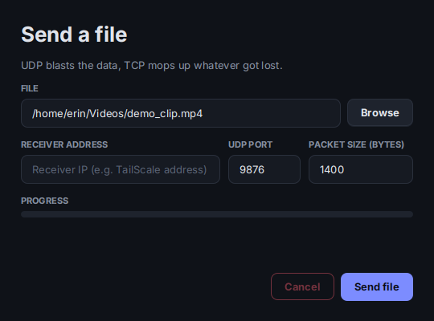
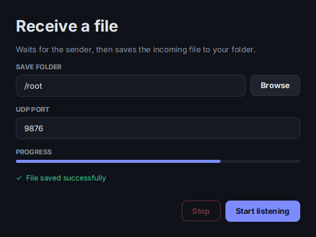

# RBUDP: Reliable Blast UDP

A file transfer app that sends files over UDP and still gets them there intact. It's an implementation of the RBUDP idea in Java, with a sender window, a receiver window, and a set of experiments that compare it with plain TCP.

This was the second of four networking projects for CS313 at Stellenbosch (2026), done with a group of four.

<p>
  
  
</p>

## How it works

UDP is fast but doesn't promise delivery, and TCP promises delivery but acknowledges everything as it goes. RBUDP tries to get both: blast the whole file out over UDP first, then use a TCP connection to clean up whatever got lost.

1. The sender opens a TCP connection and tells the receiver how many packets to expect.
2. The sender blasts every packet out over UDP, each tagged with a sequence number.
3. It then sends a "blast complete" message over TCP.
4. The receiver, which has been filing packets into a slot per sequence number (so out-of-order and duplicate packets are no problem), replies with the list of missing sequence numbers, or `ALL_RECEIVED` if nothing is missing.
5. The sender resends only the missing packets and asks again. This repeats until the receiver confirms it has everything.

The receiver then stitches the packets together and writes the file.

## My part

I built both windows and the controllers behind them: the sender and receiver UIs, `SenderController`, `ReceiverController` and `MainApp`, which can open the two windows side by side or either one alone. I also wrote the Makefile and README. Ryan wrote the receiver and ran experiment 1, Courtney wrote the sender and the packet class and ran experiment 3, and Kayla ran experiments 2 and 4.

For this portfolio version I restyled both windows. The sender also got a progress bar, which it didn't have before. It fills when the transfer finishes, since the sender only reports start and finish, not progress along the way.

## What we measured

| Experiment | What we found |
| --- | --- |
| **TCP vs RBUDP throughput** (1 to 100 MB files) | We expected RBUDP to win. It didn't. TCP held about 30 MB/s regardless of file size, while RBUDP climbed from 3.6 MB/s (1 MB) to 11.5 MB/s (100 MB) and never caught up. Our best guess is that TCP's congestion control handles the Tailscale link better than an uncontrolled blast does, but we didn't test that directly. |
| **Consistency across 15 transfers** (50 MB file) | Fairly steady once warmed up. The first trial was always slow. Coefficient of variation was 16.4% across all 15 runs and 9.6% without the first. |
| **Packet size** (100 to 2000 bytes, over loopback) | Bigger was faster all the way up: 158 ms at 100 bytes down to 9 ms at 2000. That's because loopback has no real MTU limit. Over a real network, packets above about 1500 bytes would get fragmented, so I wouldn't read 2000 as the sweet spot. |
| **Simulated congestion** (20 MB file, receive buffer from 64 KB down to 1 KB) | TCP slowed down gracefully, from 163 MB/s to 40 MB/s. RBUDP stayed between about 7 and 17 MB/s and lost thousands of packets in every run (4,600 to 7,600), which it recovered from each time. TCP was faster at every buffer size. |

So in our tests RBUDP never beat TCP, but it did what it promised: every file arrived complete even with heavy packet loss. The numbers above are from the group write-up (`Group 17 Project 2 Computer Science 313.docx`).

## Run it

You need Java 17+ and JavaFX (`sudo apt install openjfx` on Ubuntu). Then, from the project folder:

```bash
make run          # sender and receiver windows side by side
make sender       # sender only
make receiver     # receiver only
```

Add `JAVAFX_PATH=/path/to/javafx-sdk/lib` if JavaFX lives somewhere else. `make clean` deletes the compiled output.

### Sending a file

**Receiver**
1. Click **Browse** and pick a folder to save into.
2. Enter a port (default 9876) and click **Start listening**.

**Sender**
1. Click **Browse** and pick the file.
2. Enter the receiver's IP address and the same port.
3. Set the packet size in bytes (default 1400) and click **Send file**.

For two machines, we put both on Tailscale and used the receiver's Tailscale IP. Start the receiver first.

### Running the experiments

The experiment runners are console programs that skip the UI. Compile first, then:

```bash
make clean && make
java -cp out experiments.Experiment2Runner     # transfer-rate consistency
java -cp out experiments.Experiment3Runner     # packet size
```

Experiment 4 needs a few lines switched on first:

1. In `RBUDPReceiver.java`, uncomment everything under the `EXPERIMENT 4 CODE` markers.
2. In `Experiment4Runner.java`, uncomment lines 55, 91, 94 and 95.
3. Recompile with `make clean && make`, then run `java -cp out experiments.Experiment4Runner`.

The TCP baseline for Experiment 1 is the commented-out `EXPERIMENT 1 CODE` block in `ReceiverController.java`, paired with `Sender.sendTcpBaseline`.

## Project structure

```
.
├── Makefile
├── README.md
├── docs/                          screenshots
└── src
    ├── client
    │   └── Sender.java            chunking, UDP blast, retransmit loop
    ├── server
    │   └── RBUDPReceiver.java     collects packets, reports what's missing
    ├── shared
    │   └── Packet.java            sequence number + payload
    ├── controllers
    │   ├── SenderController.java
    │   └── ReceiverController.java
    ├── ui
    │   ├── MainApp.java
    │   ├── SenderUI.java
    │   ├── ReceiverUI.java
    │   └── theme.css
    └── experiments
        ├── Experiment2Runner.java
        ├── Experiment3Runner.java
        └── Experiment4Runner.java
```

## Known limits

- The whole file is read into memory before sending, so very large files will run out of memory
- The receiver saves everything as `recieved_file.dat`, so the original file name and type aren't kept
- There's no checksum, so the protocol guarantees every packet arrives but doesn't separately verify the finished file
- Packets are Java-serialised objects, which adds overhead on top of the chunk size you choose

## Team

Ryan Allen, Courtney Campbell, Erin Painting, Kayla De Beer. Group 17, CS313.
