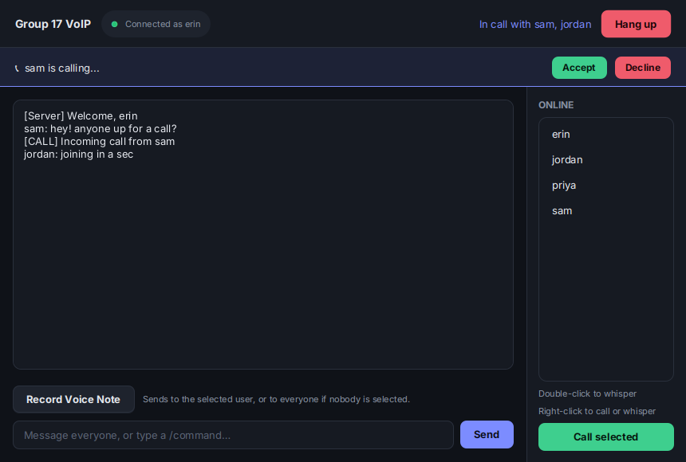
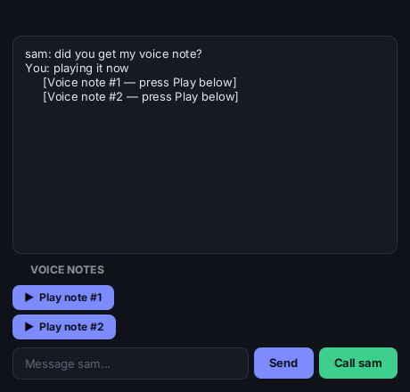
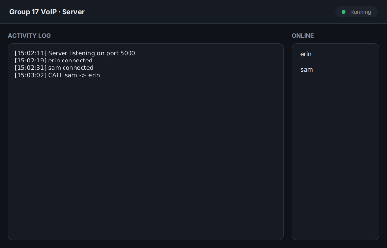

# Group 17 VoIP Chat

A voice-over-IP chat app in Java. You can text everyone, whisper to one person, send voice notes, and start voice calls, including group calls. A small server keeps track of who's online and sets calls up, and the voice itself goes straight between clients over UDP.

This was the third of four networking projects for CS313 at Stellenbosch (2026), done with a group of four.

<p>
  
  
</p>

## What it does

- **Global and private text chat**, same as our first project
- **Voice notes:** record one, send it to the selected user or to everyone, and replay it as often as you like from the private chat window
- **Voice calls:** call one person, or run `/conference alice bob` to ring several people at once
- **Group calls without a mixing server:** each client mixes the incoming audio streams itself, and call audio never goes through the server. The server only passes along who is calling whom, plus the IP and UDP port to send to. (Voice notes do go via the server, since they're just messages.)
- **Server dashboard** with a live activity log and the list of connected users
- Chat commands: `/call`, `/hangup`, `/whisper`, `/join`, `/leave`, `/conference`
- Right-click a name in the user list to call or whisper

Audio is 8 kHz, 16-bit mono. There's no echo cancellation, so wear headphones on calls or you'll get feedback.

## My part

I built the UI and tied it into the rest of the app: the chat window, the incoming-call banner, the whisper and channel windows, the voice-note panel (`WindowManager`), and the server dashboard. I also ran the sample-rate experiment. Courtney wrote the audio code, Ryan did the client networking, and Kayla built the server.

For this portfolio version I restyled everything with a shared stylesheet. I also fixed a couple of small UI bugs along the way: the status bar never updated after login, and the client ignored the port you gave it.

<p>
  
</p>

## What we measured

1. **Packet loss vs call quality.** Quality dropped straight away. At 5% loss the audio was crackly but understandable (4/5), at 20% only some sentences got through (2/5), and at 30% it was incoherent (1/5). Ratings were subjective and came from one listener, so I'd treat it as a trend, not hard numbers.
2. **Conference size vs bandwidth.** Because every client sends to every other client, the host's upload grows linearly: 16 KB/s per extra person. That's fine for a handful of people and the reason big VoIP systems use central servers.
3. **Sample rate vs perceived quality** (the one I ran). I recorded voice notes at 44.1 kHz and downsampled them to 16, 8 and 3 kHz. 16 kHz still sounded good (4/5 overall). 8 kHz sounded like a phone line (3/5) and 3 kHz was hard to follow (2/5). Again one listener, so take it with a pinch of salt.

The full write-up with the tables is in `report.pdf`.

## Run it

You need Java 17+ and JavaFX (`sudo apt install openjfx` on Ubuntu). Then, from the project folder:

```bash
make server                          # opens the server dashboard, port 5000
make client HOST=<server-ip>         # opens a client (run it once per user)
```

Both commands compile first, so there's no separate build step. Add `PORT=<port>` if you changed the port, or `JAVAFX_PATH=/path/to/javafx-sdk/lib` if JavaFX lives somewhere else. `make clean` deletes the compiled output.

We tested across different laptops over Tailscale, so put every machine on the same Tailscale network and use the server's Tailscale IP.

### Using it

- **Log in** with a username
- **Global message:** type in the main window and press Send
- **Private message:** double-click a name, then type in the window that opens
- **Voice note:** click *Record Voice Note*, click again to stop and send. It goes to whoever is selected in the user list, or to everyone if nobody is. The recipient plays it from their private chat window with that person.
- **Call:** select someone and click *Call selected*, or type `/conference <user1> <user2> ...`. The other side gets an Accept / Decline banner. *Hang up* ends it.

## Project structure

```
.
├── Makefile
├── README.md
├── report.pdf
├── docs/                          screenshots
└── src
    ├── client
    │   ├── audio
    │   │   ├── AudioConfig.java       8 kHz / 16-bit / mono
    │   │   ├── AudioSender.java       mic -> UDP
    │   │   ├── AudioReciever.java     UDP -> speakers
    │   │   └── AudioMixer.java        mixes streams for group calls
    │   └── ui
    │       ├── ChatApp.java
    │       ├── ChatController.java
    │       ├── LoginController.java
    │       ├── WindowManager.java     whisper / channel windows, voice notes
    │       ├── client.java            sockets to the server
    │       ├── ChatUI.fxml
    │       ├── login.fxml
    │       └── theme.css
    ├── server
    │   ├── Server.java
    │   └── serverUI
    │       ├── ServerApp.java
    │       ├── ServerController.java
    │       ├── ServerUI.fxml
    │       └── theme.css
    └── shared
        └── Message.java
```

## Known limits

- Text messages and voice notes go to one person or everyone, not to a chosen subset
- No echo cancellation (headphones needed)
- Calls are peer to peer, so the number of people on a call is limited by the host's upload bandwidth

## Team

Ryan Allen, Courtney Campbell, Erin Painting, Kayla De Beer. Group 17, CS313.
