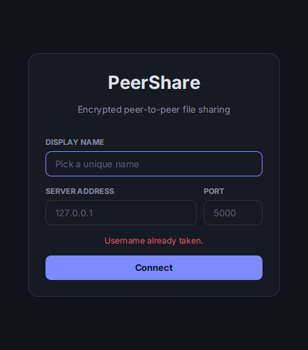
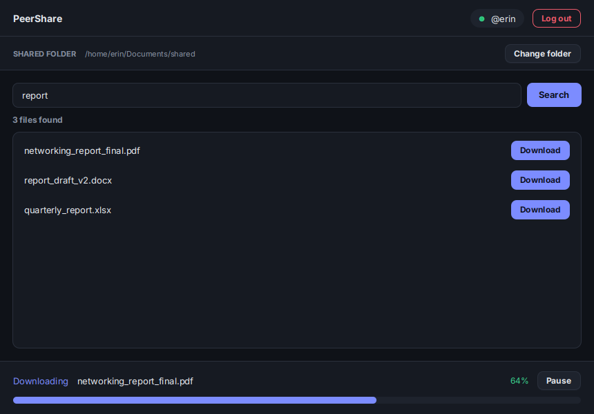

# PeerShare

Encrypted peer-to-peer file sharing in Java. You connect to a small central server, search for a file, and download it straight from the person who has it. The server never stores files and never keeps a list of who's online.

This was the fourth and last networking project for CS313 at Stellenbosch (2026), done with a group of four.

<p>
  
  
</p>

## How it works

1. **Connect.** Each client picks a name, connects to the server and shares one folder on its machine.
2. **Search.** When you search, the server forwards the query to every other client and gathers the replies for one second. You get back the matching file names along with each owner's username and public key. You never see anyone's IP address.
3. **Download.** You send a download request encrypted with the owner's public key. The server passes it on without being able to read it, and introduces the two peers so they can connect directly.
4. **Transfer.** The peers agree on a key (RSA protects the AES key), then the file is sent peer to peer, encrypted with AES in 4 KB chunks. Uploads and downloads can run at the same time, and you can pause and resume a download. Resuming picks up from the byte offset it stopped at.

Everything ran over Tailscale in testing, so the machines could reach each other regardless of where we were.

## My part

I built the UI and connected it to the networking and security code: the login screen, the main window with search, results and the download buttons, and the transfer progress panel with pause and resume. I also ran the first experiment (search time vs number of files). Ryan wrote the transfer engine, Courtney did the encryption and key handling, and Kayla built the server.

For this portfolio version I restyled the UI and renamed it PeerShare. The behaviour is unchanged.

## What we measured

| Experiment | What we found |
| --- | --- |
| **Search time vs number of shared files** (10 to 500 files; the one I ran) | Flat, at about 1.0 s every time. That's the server's fixed 1-second collection window, so file count made no difference at this scale. |
| **File size vs transfer time** (10 to 250 MB) | Time grew linearly with size. After a slower first 10 MB, the speed held steady at about 17 MB/s. |
| **Cost of AES encryption** (50 MB file, 3 trials) | Higher than we guessed. We predicted 10 to 15% overhead and measured 69%, 45% and 36% across the three trials, about 50% on average. It dropped on each run, but the trials weren't independent because of the slow start, so we can't say where it would settle. |

The full write-up is in `report.pdf`.

## Run it

You need Java 17+ and JavaFX (`sudo apt install openjfx` on Ubuntu). Then, from the project folder:

```bash
make all                 # compile the client and server
make run-server          # terminal 1, port 5000 (PORT=6000 to change it)
make run-client          # terminal 2 (run more for more peers)
```

If JavaFX lives somewhere else, add `FX_PATH=/path/to/javafx-sdk/lib` to any command. `make clean` deletes the compiled output.

### Using it

1. Start the server, then a client. Usernames have to be unique.
2. On the login screen, enter a name, the server's IP address and the port.
3. Click **Change folder**. Everything in that folder is shared, and downloads are saved there too.
4. Type a file name and hit **Search**, then **Download** next to a result.
5. Use **Pause** / **Resume** in the progress bar at the bottom if you need to.

## Project structure

```
.
├── Makefile
├── README.md
├── report.pdf
├── docs/                          screenshots
└── src
    ├── client
    │   ├── client.java                server connection
    │   ├── P2PTransferEngine.java     handshake, chunked encrypted transfer, pause/resume
    │   └── ui
    │       ├── App.java
    │       ├── LoginController.java
    │       ├── MainController.java
    │       ├── LoginView.fxml
    │       ├── MainView.fxml
    │       └── theme.css
    ├── security
    │   ├── EncryptionManager.java     RSA key pair, AES key and payload encryption
    │   ├── EncryptedMessage.java
    │   └── KeyHandler.java
    ├── server
    │   └── Server.java                search fan-out, introductions
    └── shared
        └── Message.java
```

## Things I'd change

- Public keys are handed out by the server, so a dishonest server could swap them. A real system needs a way for peers to check each other's keys.
- The 1-second search window keeps things simple but makes every search take at least a second. Returning results as they arrive would feel much faster.

## Team

Ryan Allen, Courtney Campbell, Erin Painting, Kayla De Beer. Group 17, CS313.
